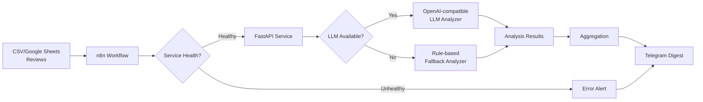
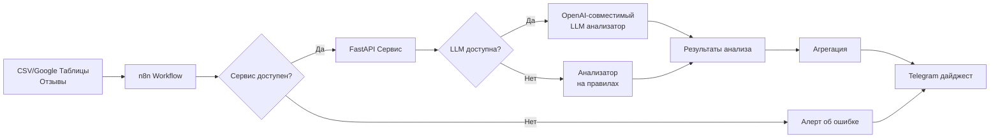

# Marketplace Review Analyzer / Анализатор отзывов с маркетплейсов

[English](#english) | [Русский](#russian)

---

<a name="english"></a>
## English

### Problem

Online marketplaces accumulate thousands of customer reviews daily. Manual analysis is time-consuming and prone to missing critical patterns. This service automates review analysis by extracting sentiment, topics, complaints, and priority levels, enabling businesses to:

- Identify critical issues requiring immediate attention
- Track sentiment trends across product categories
- Discover recurring topics and complaints
- Receive automated daily digests via Telegram

### Architecture



### Features

- **Dual Analysis Modes**: LLM-powered analysis with automatic fallback to rule-based analyzer
- **Russian Language Support**: Optimized for Russian marketplace reviews
- **Batch Processing**: Analyzes multiple reviews with aggregated statistics
- **Automated Workflow**: n8n integration for scheduled analysis and Telegram notifications
- **Docker Deployment**: Full stack runs with `docker-compose up`
- **Comprehensive Testing**: 95%+ code coverage with pytest

### Quick Start

```bash
# 1. Clone and configure
git clone <repository-url>
cd marketplace-review-analyzer
cp .env.example .env
# Edit .env: add OPENAI_API_KEY (optional), TELEGRAM_CHAT_ID

# 2. Start services
docker-compose up -d

# 3. Access services
# API: http://localhost:8000/docs
# n8n: http://localhost:5678
```

### API Usage

**Analyze Reviews:**

```bash
curl -X POST http://localhost:8000/analyze \
  -H "Content-Type: application/json" \
  -d '{
    "reviews": [
      {
        "id": "1",
        "text": "Отличный товар! Быстрая доставка.",
        "rating": 5
      }
    ]
  }'
```

**Response:**

```json
{
  "results": [
    {
      "id": "1",
      "sentiment": "positive",
      "topics": ["доставка"],
      "complaints": [],
      "priority": "low"
    }
  ],
  "summary": {
    "total_reviews": 1,
    "sentiment_distribution": {"positive": 1},
    "priority_distribution": {"low": 1},
    "top_topics": ["доставка"],
    "top_complaints": []
  }
}
```

### Sample Telegram Digest

```
📊 Analysis Complete

📈 Total Reviews: 75

😊 Sentiment:
• Positive: 45
• Neutral: 15
• Negative: 15 (20.0%)

⚠️ Priorities:
• Critical: 3
• High: 5
• Medium: 12
• Low: 55

🏷️ Top Topics:
1. quality
2. delivery
3. price

⚠️ Top Complaints:
1. broke after a week
2. doesn't match description
3. damaged packaging
```

### Running Tests

```bash
# Install development dependencies
pip install -e ".[dev]"

# Run all tests with coverage
pytest

# Run specific test suite
pytest tests/test_api.py -v

# Lint code
ruff check .
```

### Limitations

- Rule-based fallback has limited accuracy compared to LLM mode
- Currently optimized for Russian language reviews
- No authentication on API endpoints (add reverse proxy for production)
- Single-instance deployment (no horizontal scaling)
- CSV data source requires manual updates (consider database integration)

### Technology Stack

- **Backend**: FastAPI, Pydantic, uvicorn
- **Analysis**: OpenAI-compatible API, rule-based NLP
- **Automation**: n8n workflow engine
- **Testing**: pytest, pytest-asyncio, pytest-cov
- **Linting**: ruff
- **Deployment**: Docker, Docker Compose

### Contact

**Telman Nuruzov**
- Email: telmannuruzov@gmail.com
- Telegram: [@Telman3000](https://t.me/Telman3000)

---

<a name="russian"></a>
## Русский

### Проблема

Маркетплейсы ежедневно накапливают тысячи отзывов покупателей. Ручной анализ занимает много времени и может пропустить критические паттерны. Этот сервис автоматизирует анализ отзывов, извлекая тональность, темы, жалобы и уровни приоритета, что позволяет бизнесу:

- Выявлять критические проблемы, требующие немедленного внимания
- Отслеживать тренды настроений по категориям товаров
- Находить повторяющиеся темы и жалобы
- Получать автоматизированные ежедневные дайджесты в Telegram

### Архитектура



### Возможности

- **Два режима анализа**: анализ через LLM с автоматическим переключением на правила
- **Поддержка русского языка**: оптимизирован для отзывов с российских маркетплейсов
- **Пакетная обработка**: анализ множества отзывов с агрегированной статистикой
- **Автоматизированный workflow**: интеграция с n8n для планирования и уведомлений в Telegram
- **Docker развертывание**: весь стек запускается командой `docker-compose up`
- **Комплексное тестирование**: покрытие кода 95%+ с pytest

### Быстрый старт

```bash
# 1. Клонирование и настройка
git clone <repository-url>
cd marketplace-review-analyzer
cp .env.example .env
# Отредактируйте .env: добавьте OPENAI_API_KEY (опционально), TELEGRAM_CHAT_ID

# 2. Запуск сервисов
docker-compose up -d

# 3. Доступ к сервисам
# API: http://localhost:8000/docs
# n8n: http://localhost:5678
```

### Использование API

**Анализ отзывов:**

```bash
curl -X POST http://localhost:8000/analyze \
  -H "Content-Type: application/json" \
  -d '{
    "reviews": [
      {
        "id": "1",
        "text": "Отличный товар! Быстрая доставка.",
        "rating": 5
      }
    ]
  }'
```

**Ответ:**

```json
{
  "results": [
    {
      "id": "1",
      "sentiment": "positive",
      "topics": ["доставка"],
      "complaints": [],
      "priority": "low"
    }
  ],
  "summary": {
    "total_reviews": 1,
    "sentiment_distribution": {"positive": 1},
    "priority_distribution": {"low": 1},
    "top_topics": ["доставка"],
    "top_complaints": []
  }
}
```

### Пример дайджеста в Telegram

```
📊 Анализ отзывов завершен

📈 Всего отзывов: 75

😊 Настроения:
• Позитивные: 45
• Нейтральные: 15
• Негативные: 15 (20.0%)

⚠️ Приоритеты:
• Критичные: 3
• Высокие: 5
• Средние: 12
• Низкие: 55

🏷️ Топ темы:
1. качество
2. доставка
3. цена

⚠️ Частые жалобы:
1. сломался через неделю
2. не соответствует описанию
3. поврежденная упаковка
```

### Запуск тестов

```bash
# Установка зависимостей для разработки
pip install -e ".[dev]"

# Запуск всех тестов с покрытием
pytest

# Запуск конкретного набора тестов
pytest tests/test_api.py -v

# Проверка кода линтером
ruff check .
```

### Ограничения

- Анализатор на правилах имеет ограниченную точность по сравнению с LLM режимом
- В данный момент оптимизирован для отзывов на русском языке
- Нет аутентификации на API endpoints (добавьте reverse proxy для production)
- Развертывание на одном инстансе (нет горизонтального масштабирования)
- CSV источник данных требует ручного обновления (рассмотрите интеграцию с БД)

### Технологический стек

- **Backend**: FastAPI, Pydantic, uvicorn
- **Анализ**: OpenAI-совместимый API, NLP на правилах
- **Автоматизация**: движок workflow n8n
- **Тестирование**: pytest, pytest-asyncio, pytest-cov
- **Линтинг**: ruff
- **Развертывание**: Docker, Docker Compose

### Контакты

**Тельман Нурузов**
- Email: telmannuruzov@gmail.com
- Telegram: [@Telman3000](https://t.me/Telman3000)

---

## License / Лицензия

MIT License - see [LICENSE](LICENSE) file for details.
